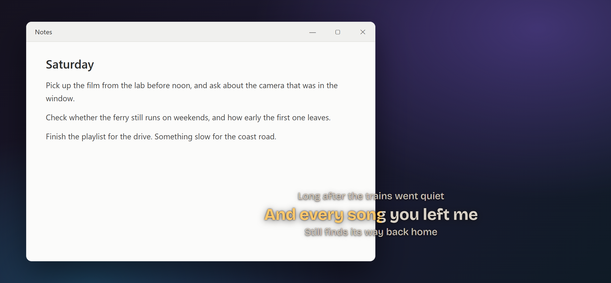
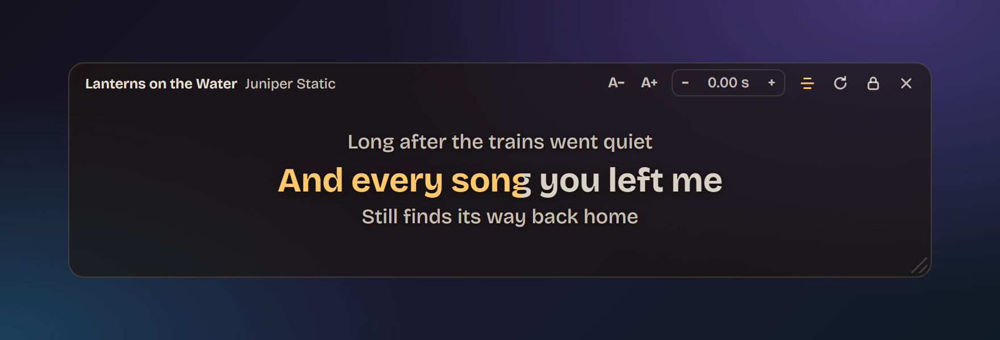

# Spotify Floating Lyrics

A small always-on-top, see-through window that shows time-synced lyrics for whatever the Spotify desktop app is playing. The current line fills in as it's sung. Built with [Tauri 2](https://tauri.app) (Rust + TypeScript), so one codebase runs on Windows, macOS and Linux.



<sub>Rendered from the app's own frontend, with made-up sample lyrics.</sub>

- **No Spotify login or API key.** Playback is read from the OS media integration on the same machine.
- **Lyrics from [LRCLIB](https://lrclib.net)**, a free, open database of synced lyrics.
- **Click-through lock** so the lyrics never block what's underneath.

> **Status:** v0.1.0. Tested on Windows 11 with the Microsoft Store version of Spotify. The Linux and macOS versions haven't been built or run yet.

## How it works

| Platform | Where "now playing" comes from |
| --- | --- |
| Windows 10/11 | System Media Transport Controls (`GlobalSystemMediaTransportControlsSessionManager`) |
| Linux | MPRIS over D-Bus (`org.mpris.MediaPlayer2.spotify*`, which also covers spotifyd) |
| macOS | Spotify's AppleScript interface via `osascript` |

A background thread polls the player every 500 ms and sends the track and position to the window. When the song changes, the backend looks it up on LRCLIB: first an exact match on title, artist, album and duration, then a fuzzy search. It prefers synced lyrics and caches results in memory. The window keeps its own clock between polls, so lines change smoothly.

```
src-tauri/src/
  lib.rs                 app wiring: poller thread, tray menu, lock shortcut, commands
  player/mod.rs          Track / Playback types, picks the right backend per OS
  player/smtc.rs         Windows
  player/mpris.rs        Linux
  player/applescript.rs  macOS
  lyrics/lrclib.rs       LRCLIB client and result matching
  lyrics/lrc.rs          LRC parser
src/
  main.ts                overlay rendering, sync clock, controls
  styles.css
```

## Running it on Windows

> **Using WSL?** Build and run on the Windows side, not inside WSL. A WSL build is a Linux app and can't see the Windows Spotify app. Clone the project to a Windows folder (for example `C:\dev\spotify-floating-lyrics`) and use PowerShell.

1. Install the prerequisites (details in [Tauri's guide](https://tauri.app/start/prerequisites/#windows)):
   - **Microsoft C++ Build Tools** with the "Desktop development with C++" workload
   - **WebView2**, which is already present on Windows 10 (1803+) and 11
   - **Rust**, from <https://rustup.rs>
   - **Node.js 20.19+ or 22.12+** (Vite 8 needs it)
2. Clone, install and start it:
   ```powershell
   git clone https://github.com/harispraba/spotify-floating-lyrics
   cd spotify-floating-lyrics
   npm install
   npm run tauri dev
   ```
3. Play something in the Spotify desktop app.

To produce an installer, run `npm run tauri build`. The installers land in `src-tauri/target/release/bundle/` (`nsis/*.exe` and `msi/*.msi`).

## Using it



- **Move:** drag anywhere on the lyrics. **Resize:** drag the grip in the bottom-right corner. Position and size are remembered.
- **Hover** (while unlocked) to show the track name and the toolbar:
  - **A− / A+:** text size
  - **− 0.00 s +:** timing offset in 0.25 s steps. Use **+** if lyrics lag behind the singing. Click the number to reset.
  - **≡:** show or hide the previous and next lines
  - **↻:** look the lyrics up again
  - **Lock:** click-through mode. The window ignores the mouse entirely.
  - **×:** hide the window
- **Unlock or show it again** from the tray icon menu, or press **Ctrl+Alt+Shift+L** (⌘⌥⇧L on macOS) to toggle the lock.

Settings are stored per machine in the window's local storage.

## Running it on Linux and macOS

Same commands (`npm install`, `npm run tauri dev`) after installing [Tauri's prerequisites](https://tauri.app/start/prerequisites/) for your OS. Neither has been tried yet, so expect rough edges, and please open an issue if something breaks.

- **Linux:** needs the official Spotify client (or spotifyd) with MPRIS on the session bus. Transparency needs a compositing window manager. The global shortcut uses X11 and may not fire under Wayland; use the tray menu there.
- **macOS:** the first run asks for permission to control Spotify (System Settings → Privacy & Security → Automation). Transparency uses Tauri's `macOSPrivateApi`, which is fine for direct distribution but not allowed on the Mac App Store.

## Known limits

- Lyrics coverage is whatever LRCLIB has. For songs with only plain (unsynced) lyrics, the window says so instead of guessing timings. You can contribute synced lyrics at lrclib.net.
- Spotify on Windows only updates its reported position on play, pause and seek, so the app extrapolates from the last update. If lyrics drift on your machine, the timing offset fixes it.
- Only the Spotify desktop app on the same computer is detected. The web player and other devices aren't. Supporting them would need the Spotify Web API and a Spotify developer app.

## Troubleshooting

When you run it with `npm run tauri dev`, errors are printed in that terminal.

| Symptom | Likely cause | What to do |
| --- | --- | --- |
| Says "Play a song in Spotify…" while a song is playing | The app can't see Spotify's media session | Check it's the desktop app on the same computer, not the web player. Look in the terminal for `failed to read Spotify playback: …` |
| Says "Couldn't get lyrics from LRCLIB" | LRCLIB is busy or can't be reached | It tries again on its own while the song plays. Press ↻ to try straight away |
| Every line is early or late by the same amount | That LRCLIB entry's timing | Use the timing offset in the toolbar |
| Lyrics drift during a song, or jump after pause or seek | The reported position isn't extrapolated correctly | Please open an issue with the song and what you saw |
| Shows the last line as soon as a song starts | A media session without timeline info | See BUG-01 in [TRACKING.md](TRACKING.md) |
| White or black box behind the text | Transparency isn't working | Update WebView2 |
| Ctrl+Alt+Shift+L does nothing | Another app has claimed the shortcut | Use the tray menu. The terminal shows `could not register …` |
| The window opens off-screen | Its saved position is on a monitor that's gone | Delete `%APPDATA%\com.harispraba.spotifyfloatinglyrics\.window-state.json` |
| Settings seem stuck | A bad value in local storage | In a dev build, right-click → Inspect and run `localStorage.clear()` in the console |

## Development

```bash
npm run build                                                     # type-check + bundle the frontend
cargo test --manifest-path src-tauri/Cargo.toml                   # LRC parser and LRCLIB matching tests
cargo clippy --manifest-path src-tauri/Cargo.toml --all-targets
cargo fmt --manifest-path src-tauri/Cargo.toml
```

Open work and known bugs are tracked in [TRACKING.md](TRACKING.md). [CLAUDE.md](CLAUDE.md) has the conventions and gotchas. It's written for Claude Code, but it's just as useful to read yourself.

### Design notes

These choices are deliberate:

- **Playback comes from the OS media integration, not the Spotify Web API.** That way there's no login, no Spotify developer app and no rate limits. The cost is that only the desktop app on the same machine is seen. Web API support is FEAT-16.
- **Lyrics come from LRCLIB**, which is free, needs no key and has synced lyrics.
  - The lookup tries the exact `/get` endpoint first, then `/search` with a cleaned title and the first artist, then a free-text search.
  - Results whose length is more than 4 s off are rejected, because they're most likely a different recording.
  - Synced lyrics beat plain ones.
  - Server errors (5xx) are retried once after 800 ms.
  - Failed lookups aren't cached. While the song plays, they're retried after 3, 10 and 30 s and then every minute, and reload tries again at once.
- **Lookups wait until a song shows up on two polls in a row.** Skipping through songs then doesn't fire a request for each one, and the duration has time to settle.
- **The window runs its own clock.** It only resyncs when it's more than 400 ms away from what Spotify reports, so lines don't jitter with poll timing. A line takes at most 7 s to fill.
- **The poller is a plain thread, not a tokio task**, because the SMTC, D-Bus and osascript calls all block. The lyrics fetch is async.
- **Only window position and size are restored.** Restoring visibility as well could start the app hidden.
- **Unsynced lyrics show a message** instead of guessed timings. Showing them properly is FEAT-10.
- **reqwest uses native-tls**, which is SChannel on Windows. This keeps aws-lc-rs and its C build out of the dependency tree.

## License

[MIT](LICENSE). Lyrics come from LRCLIB and belong to their owners.

This project isn't affiliated with or endorsed by Spotify.
